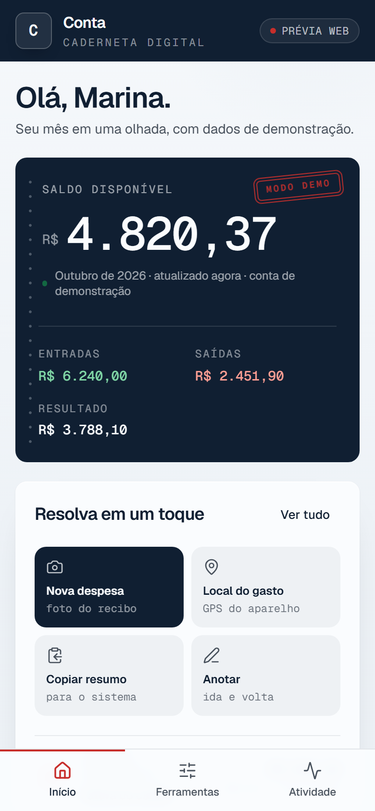
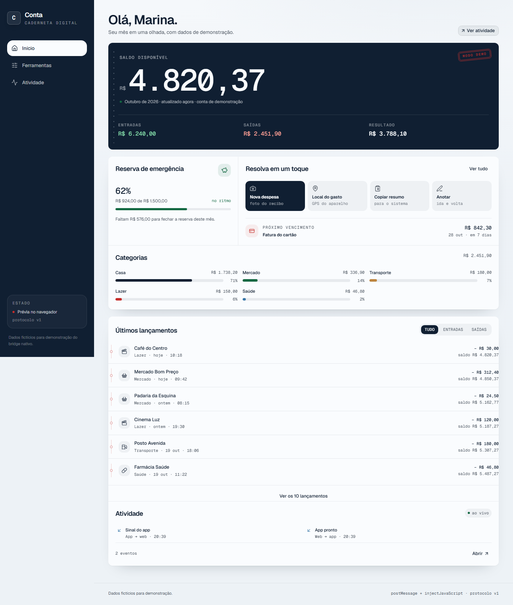
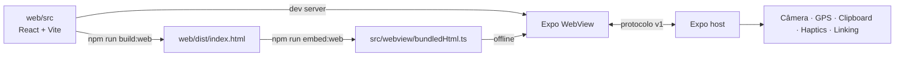

# Conta

Prova de conceito de um app de finanças rodando dentro de um **WebView do Expo** e conversando com o host nativo por um protocolo JSON versionado. A interface foi construída como uma caderneta digital: saldo, meta, categorias, lançamentos e um feed de atividade que mostra cada chamada nativa.


<p align="center">
  
  
</p>

## Índice

- [Funcionalidades](#funcionalidades)
- [Começando](#começando)
  - [Requisitos](#requisitos)
  - [Instalação](#instalação)
  - [Prévia somente web](#prévia-somente-web)
  - [App nativo com o Vite em desenvolvimento](#app-nativo-com-o-vite-em-desenvolvimento)
  - [App nativo com o bundle offline](#app-nativo-com-o-bundle-offline)
  - [Builds na nuvem com EAS](#builds-na-nuvem-com-eas)
  - [Scripts](#scripts)
- [Arquitetura](#arquitetura)
- [Como funciona](#como-funciona)
- [Protocolo v1](#protocolo-v1)
- [Estrutura do projeto](#estrutura-do-projeto)
- [Verificações](#verificações)
- [Gitflow](#gitflow)
- [Limitações conhecidas](#limitações-conhecidas)
- [Licença](#licença)

## Funcionalidades

- **Início** com saldo, entradas e saídas, meta mensal, próximo vencimento, categorias e lançamentos com saldo corrente.
- **Ferramentas** para câmera, localização, anotações, parcelas, clipboard, resposta tátil, dados do aparelho e ações nativas.
- **Atividade** com feed legível e payload JSON original de cada requisição, resposta e evento.
- **Modo nativo e modo navegador**: o WebView usa as APIs do Expo; no navegador, um mock cobre as mesmas ações.
- **Bundle offline**: o build web vira um único HTML embutido no app, sem depender de servidor.
- **Layout responsivo**: navegação inferior no celular e rail fixo no desktop.

## Começando

### Requisitos

- Node.js **22.13 (LTS)** ou **24.3+** (versões exigidas pelo Expo 58).
- npm.
- Um dispositivo ou emulador Android/iOS para testar as APIs nativas de verdade.

### Instalação

O projeto tem dois `package.json`: o host Expo na raiz e o web app em `web/`.

```bash
npm install
npm --prefix web install
```

### Prévia somente web

```bash
npm run web
```

Abre o Vite em `http://localhost:5173`. Nesse modo, câmera, GPS, clipboard e demais ações usam os mocks de `web/src/lib/mock-native.ts`.

### App nativo com o Vite em desenvolvimento

Crie um `.env` na raiz a partir de `.env.example` e escolha o endereço do servidor Vite:

```bash
cp .env.example .env
```

No PowerShell, use `Copy-Item .env.example .env`.

| Ambiente | `EXPO_PUBLIC_WEBVIEW_URL` |
| --- | --- |
| Emulador Android | `http://10.0.2.2:5173` |
| Simulador iOS | `http://localhost:5173` |
| Dispositivo físico | `http://SEU_IP_LAN:5173` |

Com o Vite rodando em um terminal, inicie o Expo em outro:

```bash
npm start
```

O host limita a navegação do WebView à origem configurada em `EXPO_PUBLIC_WEBVIEW_URL`.

### App nativo com o bundle offline

Deixe `EXPO_PUBLIC_WEBVIEW_URL` vazio ou remova a variável do `.env`, gere o bundle e inicie o Expo:

```bash
npm run build:web
npm start
```

`npm run build:web` executa o build do Vite e regenera `src/webview/bundledHtml.ts`.

### Builds na nuvem com EAS

Os perfis de build ficam no `eas.json` da raiz. Antes do primeiro build, autentique e vincule o projeto:

```bash
npx eas-cli@latest login
npx eas-cli@latest init
```

| Perfil | O que entrega | Quando usar |
| --- | --- | --- |
| `development` | APK com dev client para instalar no aparelho e conectar no `npm start`. | Iterar no dispositivo com o Metro. |
| `preview` | APK de distribuição interna, já com o bundle offline embutido. | Mostrar para outras pessoas sem servidor. |
| `production` | Build de loja (AAB no Android), com `submit` configurado. | Submeter para as lojas. |

```bash
npx eas-cli@latest build --profile development --platform android
npx eas-cli@latest build --profile preview --platform android
npx eas-cli@latest build --profile production --platform all
npx eas-cli@latest submit --profile production
```

- O build na nuvem usa o HTML embutido em `src/webview/bundledHtml.ts`. Rode `npm run build:web` depois de alterar o web app para o bundle não ficar defasado.
- `EXPO_PUBLIC_WEBVIEW_URL` é só para o desenvolvimento local. Na nuvem, sem a variável definida o app abre o bundle offline; para apontar um build para um servidor específico, defina a URL como variável de ambiente do EAS.
- Os perfis `development` e `preview` geram APK para instalação direta. iOS com distribuição interna exige aparelhos registrados na conta Apple.

### Scripts

| Comando | Onde | O que faz |
| --- | --- | --- |
| `npm start` | raiz | Inicia o servidor de desenvolvimento do Expo. |
| `npm run android` | raiz | Abre o app no Android. |
| `npm run ios` | raiz | Abre o app no iOS. |
| `npm run web` | raiz | Inicia o Vite do web app. |
| `npm run build:web` | raiz | Builda o web app e embute o HTML no host. |
| `npm run embed:web` | raiz | Apenas regenera `src/webview/bundledHtml.ts`. |
| `npm run typecheck` | raiz | Typecheck do host Expo. |
| `npm run lint` | raiz | Lint do host Expo. |
| `npm test` | raiz | Roda a suíte Jest do host. |
| `npm run test:watch` | raiz | Suíte Jest em modo watch. |
| `npm --prefix web run dev` | raiz | Equivalente a `npm run web`. |
| `npm --prefix web run build` | raiz | Build do web app em `web/dist/`. |
| `npm --prefix web run preview` | raiz | Serve o build web localmente. |
| `npm --prefix web run lint` | raiz | Lint do web app. |

## Arquitetura



O host Expo (`App.tsx`) mantém o WebView, valida as mensagens, executa a API nativa correspondente e devolve a resposta. O web app (`web/`) é a interface Conta. O protocolo e os tipos compartilhados ficam em `shared/bridge.ts`.

## Como funciona

1. O web app carrega e envia `web.ready` ao host.
2. Uma ação da interface vira uma requisição `{ v: 1, kind: "request", id, action, payload }`.
3. O web app envia a requisição por `ReactNativeWebView.postMessage`.
4. O host valida a ação, executa a API do Expo e injeta a resposta no WebView.
5. O web app registra requisição, resposta e eventos no feed de Atividade, incluindo o JSON original.
6. Eventos nativos (`native.ping`, `native.counter.changed`, `native.log`) seguem o caminho inverso.

## Protocolo v1

### Ações web → nativo

| Ação | Payload | Resultado |
| --- | --- | --- |
| `device.info` | — | Plataforma, versão, modelo, tela e app. |
| `camera.takePhoto` | `{ quality?: number }` | Foto em data URL ou `null` se cancelada. |
| `location.current` | — | Latitude, longitude, precisão e timestamp. |
| `haptics.impact` | `{ style: "light" \| "medium" \| "heavy" }` | Estilo aplicado. |
| `clipboard.write` | `{ text: string }` | Quantidade de caracteres copiada. |
| `clipboard.read` | — | Texto atual da área de transferência. |
| `native.echo` | `{ message: string }` | Mensagem devolvida com timestamp. |
| `native.counter` | `{ delta: number }` | Valor acumulado no host. |
| `ui.alert` | `{ title, message }` | Confirmação de exibição. |
| `link.open` | `{ url: string }` | Confirmação de abertura. |

### Eventos

- **Nativo → web:** `native.ping`, `native.counter.changed`, `native.log`.
- **Web → nativo:** `web.ready`, `web.hello`.

## Estrutura do projeto

```text
.
├─ App.tsx                    # Host Expo, WebView, permissões e bridge
├─ index.ts                   # Entrada do Expo
├─ eas.json                   # Perfis de build do EAS
├─ __tests__/                 # Suíte Jest do host (protocolo e ações)
├─ shared/bridge.ts           # Protocolo v1, tipos e lista de ações
├─ src/
│  ├─ bridge/                 # Parsing de mensagens e ações nativas
│  └─ webview/bundledHtml.ts  # HTML único gerado para uso offline
├─ scripts/embed-web.mjs      # Gera o bundle embutido
├─ web/
│  ├─ src/
│  │  ├─ App.tsx              # Shell, navegação e atividade
│  │  ├─ components/          # Home, ferramentas, ledger e painéis
│  │  └─ lib/                 # Dados, activity, bridge e mocks
│  ├─ vite.config.ts
│  └─ package.json
├─ assets/                    # Ícones e splash do Expo
├─ docs/screenshots/          # Capturas usadas neste README
├─ DESIGN.md                  # Sistema visual e regras de interface
├─ PRODUCT.md                 # Contexto e princípios do produto
└─ .env.example               # URL opcional do Vite
```

## Verificações

A suíte automatizada cobre o protocolo (`shared/bridge.ts`), o parsing das mensagens recebidas do WebView e as dez ações nativas, com os módulos Expo mockados. Câmera, GPS, clipboard e demais APIs seguem exigindo QA manual em dispositivo ou emulador, com as permissões concedidas.

```bash
npm run typecheck
npm run lint
npm test
npm --prefix web run lint
npm --prefix web run build
npx expo-doctor
```

Os testes ficam em `__tests__/` e usam Jest com o preset `jest-expo`.

## Gitflow

- `main`: versões estáveis.
- `develop`: integração contínua.
- `feature/*`: uma branch por funcionalidade, criada a partir de `develop`.
- Features entram em `develop` com merge `--no-ff`.
- Commits seguem Conventional Commits (`feat:`, `fix:`, `docs:`, `chore:`).

## Limitações conhecidas

- Todos os dados financeiros são fictícios; não existe conta, autenticação, backend ou integração bancária.
- No navegador, as ações nativas são simuladas e não representam permissões ou hardware reais.
- Câmera, GPS e clipboard precisam ser validados em dispositivo/emulador com as permissões concedidas.
- Alterações no web app exigem `npm run build:web` para atualizar o bundle offline.
- É uma POC: o protocolo é local e confiável dentro do WebView, sem assinatura, criptografia ou isolamento de produção.
- As pastas `ios/` e `android/` são geradas pelo Expo e não são versionadas.

## Licença

MIT. Consulte [LICENSE](LICENSE).
